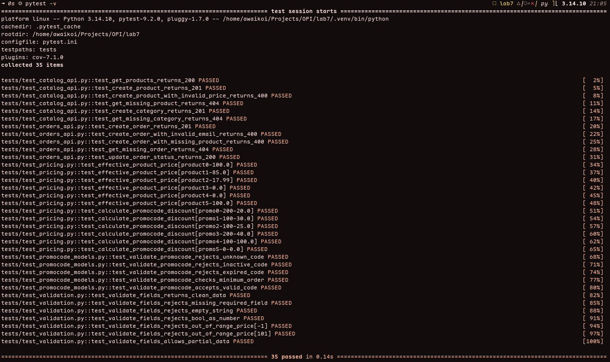
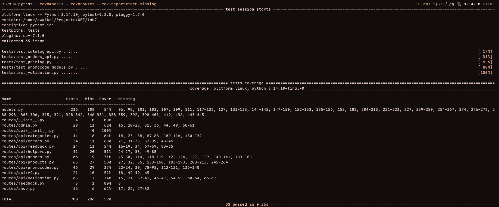

# TESTING.md — Лабораторна робота 07

## 1. Команди запуску тестів

Для запуску всіх автоматизованих тестів використовується команда:

```bash
pytest -v
```

Для вимірювання покриття коду тестами:

```bash
pytest --cov=models --cov=routes --cov-report=term-missing
```

## 2. Unit-тести

Unit-тести перевіряють окремі функції застосунку без виконання HTTP-запитів.

| Назва тесту | Що перевіряє | Очікуваний результат |
|---|---|---|
| `test_validate_fields_returns_clean_data` | Очищення вхідних рядків від зайвих пробілів | Повертаються очищені дані |
| `test_validate_fields_rejects_missing_required_field` | Перевірку обов'язкових полів | Виникає `ApiError` зі статусом 400 |
| `test_validate_fields_rejects_empty_string` | Перевірку порожніх рядків | Виникає помилка валідації |
| `test_validate_fields_rejects_bool_as_number` | Перевірку типу числових полів | Значення `True` відхиляється |
| `test_validate_fields_rejects_out_of_range_price` | Перевірку допустимих меж ціни | Значення поза межами відхиляються |
| `test_validate_fields_allows_partial_data` | Часткове оновлення даних | Відсутні обов'язкові поля не викликають помилку |
| `test_effective_product_price` | Розрахунок ціни товару з урахуванням знижки | Повертається правильна ціна |
| `test_calculate_promocode_discount` | Розрахунок знижки промокоду | Повертається правильна сума знижки |
| `test_validate_promocode_rejects_unknown_code` | Перевірку неіснуючого промокоду | Повертається повідомлення про помилку |
| `test_validate_promocode_rejects_inactive_code` | Перевірку неактивного промокоду | Промокод відхиляється |
| `test_validate_promocode_rejects_expired_code` | Перевірку простроченого промокоду | Промокод відхиляється |
| `test_validate_promocode_checks_minimum_order` | Перевірку мінімальної суми замовлення | Промокод не застосовується |
| `test_validate_promocode_accepts_valid_code` | Перевірку дійсного промокоду | Промокод приймається |

## 3. Integration-тести

Integration-тести перевіряють взаємодію API, моделей та бази даних за допомогою HTTP-запитів.

### 3.1. API товарів та категорій

| Назва тесту | HTTP-запит | Очікуваний код відповіді |
|---|---|---:|
| `test_get_products_returns_200` | `GET /api/v1/products` | 200 |
| `test_create_product_returns_201` | `POST /api/v1/products` | 201 |
| `test_create_product_with_invalid_price_returns_400` | `POST /api/v1/products` з некоректною ціною | 400 |
| `test_get_missing_product_returns_404` | `GET /api/v1/products/999999` | 404 |
| `test_create_category_returns_201` | `POST /api/v1/categories` | 201 |
| `test_get_missing_category_returns_404` | `GET /api/v1/categories/999999` | 404 |

### 3.2. API замовлень

| Назва тесту | HTTP-запит | Очікуваний код відповіді |
|---|---|---:|
| `test_create_order_returns_201` | `POST /api/v1/orders` | 201 |
| `test_create_order_with_invalid_email_returns_400` | `POST /api/v1/orders` з некоректним email | 400 |
| `test_create_order_with_missing_product_returns_400` | `POST /api/v1/orders` з неіснуючим товаром | 400 |
| `test_get_missing_order_returns_404` | `GET /api/v1/orders/999999` | 404 |
| `test_update_order_status_returns_200` | `PATCH /api/v1/orders/{id}/status` | 200 |

## 4. Результати виконання тестів

### 4.1. Результат запуску `pytest -v`

За результатами запуску всіх автоматизованих тестів отримано:

| Показник | Результат |
|---|---:|
| Загальна кількість тестових випадків | 35 |
| Unit-тести | 24 |
| Integration-тести | 11 |
| Успішно пройшли | 35 |
| Не пройшли | 0 |
| Помилки виконання | 0 |

Усі 35 тестових випадків завершилися успішно (`PASSED`).

**Скріншот результату виконання `pytest -v`:**



### 4.2. Результат вимірювання покриття коду

Для вимірювання покриття використовувався плагін `pytest-cov`.

| Показник | Результат |
|---|---:|
| Загальна кількість операторів | 700 |
| Виконано операторів | 414 |
| Не виконано операторів | 286 |
| Загальне покриття коду | 59% |

**Скріншот звіту про покриття коду:**



## 5. Висновки

Під час виконання лабораторної роботи було розроблено автоматизовані модульні та інтеграційні тести для Flask-застосунку інтернет-магазину.

За допомогою unit-тестів перевірено:
- валідацію вхідних даних;
- розрахунок ефективної ціни товарів;
- розрахунок знижок;
- перевірку промокодів.

За допомогою integration-тестів перевірено:
- отримання та створення товарів;
- роботу категорій;
- створення замовлень;
- перевірку некоректних даних;
- обробку запитів до неіснуючих ресурсів;
- зміну статусу замовлення.

Для запуску тестів використовувався фреймворк Pytest, а для вимірювання покриття — pytest-cov.

У результаті виконання було успішно пройдено всі 35 тестових випадків. Загальне покриття коду тестами становить 59%.

Отримані результати підтверджують коректність роботи перевірених функцій та API-сценаріїв застосунку.
